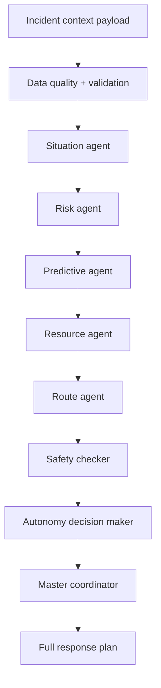

# AI agent architecture

The AI pipeline is implemented as a coordinated set of specialized agents executing in sequence. Each agent is responsible for one critical layer of emergency analysis and contributes to the final `FullResponsePlan` returned by the service.

## Agent responsibilities

### Data quality and validation

- confirm required fields are present
- detect missing or inconsistent incident data
- reduce the chance of low-quality models or unsafe recommendations

### Situation agent

- identify the incident nature and likely impact
- assess vulnerable populations and immediate context
- produce a normalized situational baseline

### Risk agent

- estimate likely severity and priority
- score the incident using ML and fallback heuristics
- surface explanations for why a risk level was assigned

### Predictive agent

- forecast whether the incident will worsen
- consider rainfall, water level, and elevation trends
- provide escalation warnings when conditions are expected to deteriorate

### Resource agent

- determine which units can assist
- match resource capabilities to the incident needs
- prioritize the best available options

### Route agent

- evaluate travel feasibility and likely pathing
- incorporate operational constraints from road or route data
- provide timed route estimates for planning purposes

### Safety checker and autonomy decision maker

- block unsafe or high-risk recommendations
- identify cases where human review is required
- ensure the workflow remains explainable and reviewable

### Master coordinator

- orchestrate the full analysis pipeline
- aggregate warnings and reasons
- return a final structured response plan with trace data

## Result format

The final response is used by the backend and the dashboard. It includes:

- incident summary
- risk assessment
- predictive output
- recommended assignments
- explanation strings
- warnings
- confidence and fallback status
- trace metadata for review

## Operational guardrails

The project explicitly favors a human-in-the-loop process. AI recommendations are presented to operators for validation rather than being treated as direct autonomous execution commands.
