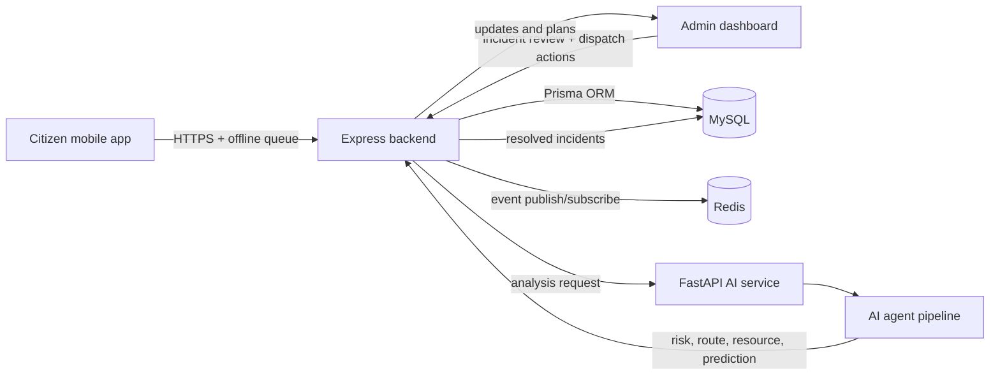

# System architecture

Rakshak is structured as a small distributed operations system: a citizen-facing mobile client, an operator-facing web console, an Express API, a MySQL data layer, Redis event processing, and a separate Python AI analysis service.

## Layer responsibilities

### Client layer

- Mobile app captures location, emergency type, and incident details
- Admin frontend provides a command-and-control view for incidents and AI recommendations
- Both clients rely on the backend API for persistence and live update ingestion

### API layer

The backend is responsible for:

- authenticating and authorizing users
- storing incidents, resources, hospitals, roads, and related domain data
- exposing event endpoints for live updates
- submitting incident analysis requests to the AI service
- persisting AI-produced dispatch plans

### Data layer

MySQL provides the relational model for persistent state. Prisma manages the data model and provides type-safe queries for the Node.js application.

### Event layer

Redis provides a lightweight event bus for updates such as `SOS_RECEIVED`, `DISPATCH_PLANNED`, and `ROAD_BLOCKED`.

### AI layer

The Python service performs validation, risk scoring, predictive analysis, resource assignment, and route reasoning. It emits structured output that the backend persists and exposes to the operator interface.

## High-level flow

1. A citizen submits an SOS or incident update.
2. The backend records the incident in MySQL and publishes a live event.
3. The operator reviews the event in the dashboard.
4. The backend triggers the AI service for a full-response assessment.
5. AI outputs are stored as a dispatch plan and surfaced to the operator.
6. A human signs off on the plan before operational execution.

## Operational constraints

- AI responses are advisory and should not be treated as autonomous dispatch actions.
- The backend and AI service are intentionally separate so that model behavior can evolve without changing the API contract.
- Local development relies on Dockerized MySQL and Redis plus Python and Node services running in separate processes.
